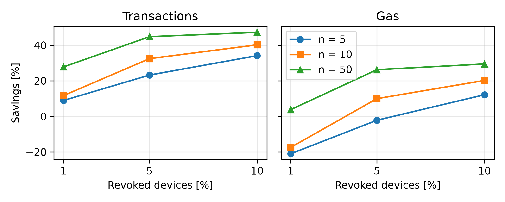

# Time-Window Revocation Filters

Proof of concept for the paper *Reducing Blockchain Transactions in Pseudonym
Revocation Using Time-Window Filters* (VYBSEM, FIIT STU, 2026).

In the scheme of Cui et al. (2024), revoked pseudonyms are inserted into one
filter on the blockchain and later deleted one by one, so every revoked
pseudonym costs two transactions. We propose a separate filter for each time
window, which is discarded as a whole with a single transaction when the
window ends. This project compares both designs on a local Ethereum network.

## Project structure

| File | Description |
|---|---|
| `chain/contracts/OriginalFilter.sol` | Original design: one filter, each pseudonym inserted and removed separately |
| `chain/contracts/WindowFilter.sol` | Proposed design: one filter per time window, discarded as a whole |
| `simulation.py` | Generates the revocation scenario - which devices are revoked, when, and how many pseudonyms remain |
| `chain_sim.py` | Deploys the contracts, runs a scenario on the blockchain and measures transactions and gas |
| `combinations.py` | Runs all parameter combinations and saves the results to `results.csv` |
| `plot.py` | Prints a table of savings and creates the graph `results.png` |

## Simulation settings

- 1000 devices, 100 time windows
- batch sizes n = 5, 10, 50 (pseudonyms issued to a device at once)
- share of revoked devices p = 1 %, 5 %, 10 %
- each setting repeated 3 times (seeds 0, 1, 2)

## Requirements

- Node.js (LTS)
- Python 3.13 

## How to run

1. Install and compile the contracts:
   ```
   cd chain
   npm install
   npx hardhat build
   ```
2. Start the local blockchain and keep this terminal open:
   ```
   npx hardhat node
   ```
3. In a second terminal, in the main folder, install the Python libraries:
   ```
   py -3.13 -m pip install web3 matplotlib
   ```
4. Run all simulations (takes etc. 20 min):
   ```
   py -3.13 combinations.py
   ```
5. Create the table and graph:
   ```
   py -3.13 plot.py
   ```

## Results



The proposed design reduced the number of revocation transactions by 9–47 %.
Gas consumption decreased by up to 30 %, but increased when windows contained
only a few revoked pseudonyms, because Ethereum refunds part of the gas when a
stored value is deleted.

## Limitations

- Filters are simplified to Solidity mappings instead of cuckoo filters.
- Discarded windows are only marked as invalid. Their data remain on the blockchain.